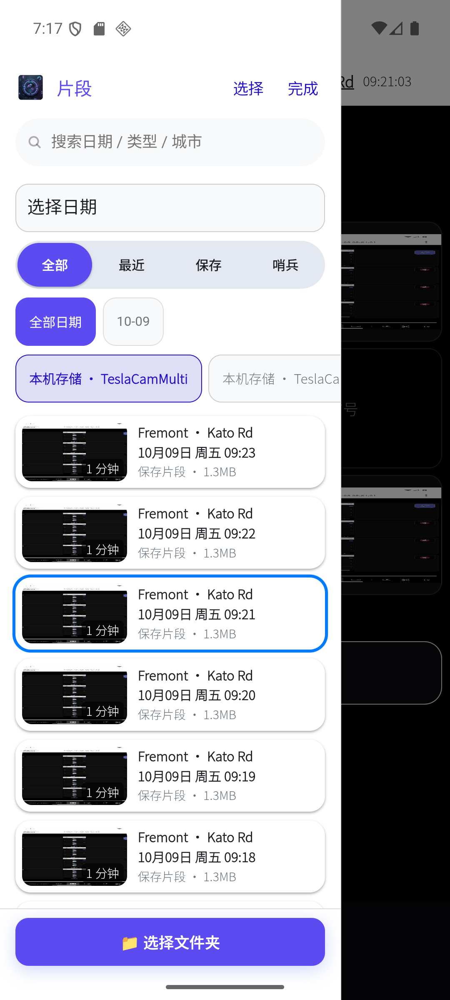
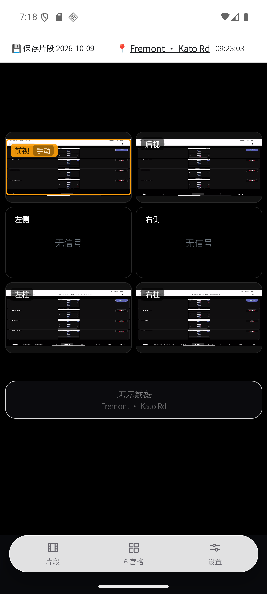
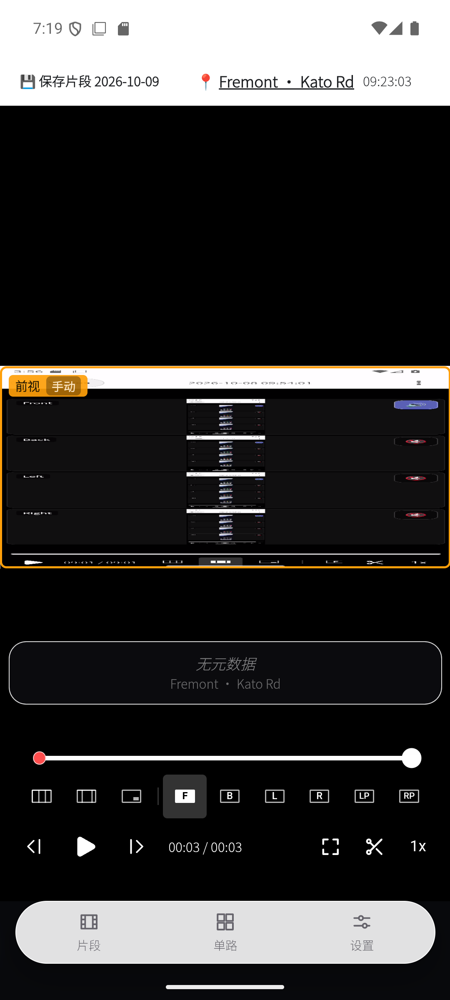
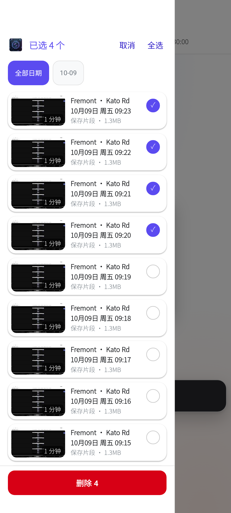
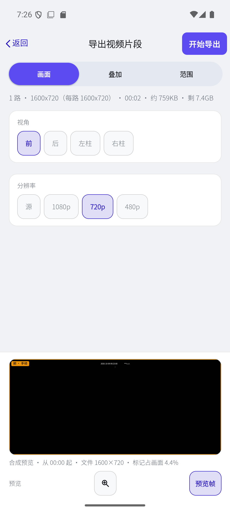
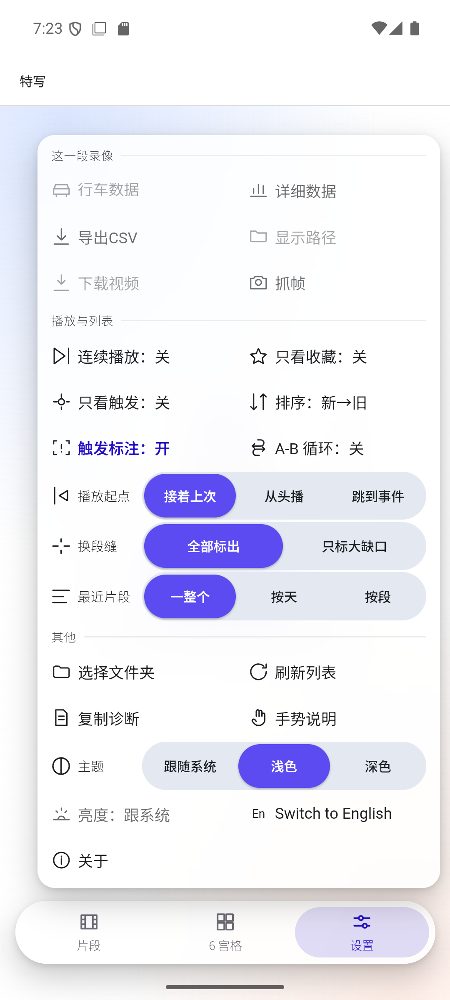
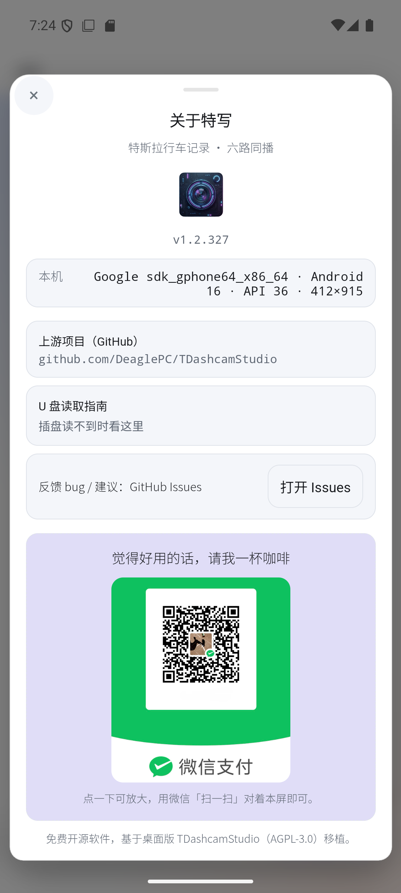

# 特写 · Tessera (Android)

**Tesla's six dashcam feeds and its driving telemetry, watched on the phone.**

A Tesla dashcam writes six videos at once (front, back, left, right, left B-pillar, right B-pillar)
plus telemetry stuffed into H.264 SEI: speed, gear, steering angle, pedals, Autopilot state, GPS.
On a desktop that means a browser, a file copy and a transcode. On a phone this app reads the card
directly — plug the USB stick in and browse, play, cut and share.

Built on [Tauri 2](https://tauri.app): Rust does the scanning and parsing, Kotlin does the decoding
and export, the UI is a WebView.

<p align="center">English | <a href="README_CN.md">简体中文</a></p>

<p align="center">
  <a href="https://github.com/clrs520/tessera-android/releases/latest"></a>
  
  
  
  <a href="LICENSE"></a>
</p>

## Support the port

If this Android port is useful to you, you can buy me a coffee (WeChat Pay):

<p align="center"></p>

## Download & install

1. Get `Tessera-<version>.apk` from **[Releases](https://github.com/clrs520/tessera-android/releases/latest)**
   — a universal package containing arm64-v8a and x86_64, about 28 MB, Android 7.0 and up.
2. Open the APK on the phone and allow "install unknown apps".
3. On first launch, grant **"All-files access"** as the app asks — TeslaCam folders are read by absolute
   path, and on Android 11+ that is the only way a sideloaded app can do it (see
   [Permissions & privacy](#permissions--privacy)).
4. Tap "Choose folder" and pick `TeslaCam` (or any level below it: `RecentClips`, `SavedClips`, `SentryClips`).

**Upgrading**: install the new APK over the old one — settings, favourites and playback positions are kept
in the app's private storage. **Verifying**: every release body carries the APK's SHA-256, so
`sha256sum Tessera-x.y.z.apk` can check it.

> There is no Google Play build; releases are built and signed with the local toolchain and published to GitHub.

## Screens

Captured on an Android emulator with **synthetic demo footage** (not real road recordings). The UI is
shown in Simplified Chinese; English is built in as well.

| Clip list: real-frame thumbnails, date chips, type filter | 6-grid sync: triggered camera outlined, missing feed says "no signal" | Single view: layout & camera picker, scrubber, speed |
|---|---|---|
|  |  |  |

| Batch select: hold and drag across cards, delete the run, undo | Export: view / overlay / range tabs, preview before exporting | Settings: every preference is a direct pick, no paging |
|---|---|---|
|  |  |  |

## What it does

### Playback

- **Six feeds in sync** on one timeline. A camera missing from a segment shows "no signal" instead of
  stalling the whole event.
- **Four layouts**: 6-grid, 4-grid, picture-in-picture, single fullscreen; in single view switch cameras
  with F / B / L / R / LP / RP.
- **No seam flash**: at a segment boundary the last frame is held until every visible feed is ready, then
  all are released together — no black blink, no clock jump.
- **Speed**: 0.5×–8×, long-press for a temporary 3×, and lifting your finger while dragging the scrubber
  switches to fine control (~0.1 s per pixel).
- **Resumable**: each event remembers where you stopped; also configurable to restart or jump to the
  trigger point.
- **Continuous play**: roll into the next event when one ends.

### Driving telemetry

- Decoded straight from the SEI in the video: **speed, gear, steering angle, turn signals, brake,
  accelerator, Autopilot state, GPS position and heading, acceleration**.
- The speed pill can be dragged to any corner and stays there; the detailed-data panel lists every field
  plus statistics.
- A **speed curve** sits on the timeline — tap any point to jump to that second.
- **CSV export** of the whole telemetry run, for other tools.

### Finding clips

- Event cards carry **real-frame thumbnails** (native grab + on-disk cache), a localised date with
  weekday, duration, source (saved clip / sentry / recent) and size.
- Filters: type as a four-way direct pick, "triggered only", "starred only", date chips, free-text search
  over date / type / city, newest-first or oldest-first.
- The list is windowed, so thousands of events still scroll smoothly and a fast flick does not leave gaps.
- Pull-to-refresh keeps the list and the scroll position; swipe a row to delete it; **hold and drag** to
  select a run of events, delete them in one go, undo.

### Cutting & export

- Set in/out points on the timeline (or swipe across the filmstrip to frame a range), name a clip, A-B loop.
- **Native export** (`MediaCodec` decode → GL composition → encode): arrange the feeds however you like,
  positions swap automatically, and each camera gets its own resolution (source / 1080p / 720p / 480p).
- Overlays: camera label, trigger badge, timestamp, watermark, privacy blur — with a composited preview
  frame before you commit.
- Export runs in a foreground service: it survives the screen turning off and the app going to the
  background, reports progress in the notification, checks free space first, and shares when done.

### USB sticks & external storage

- Read a TeslaCam stick over OTG — no copy to internal storage first.
- Streaming scan in Rust, cards appear while it walks; a per-volume **size index** plus a
  **directory-listing cache** take a 61k-file re-scan from ~30 s to ~1 s.
- Plugging the drive in refreshes the list: `MEDIA_*` mount broadcasts and a `USB_DEVICE_ATTACHED`
  filter, so it works even after the process was killed.
- FAT32 and exFAT both measured; a 2 TB drive scans to completion.

### The phone part

- Bottom action bar (clips / layout / settings) in thumb reach, drawer navigation, iOS-style sheets,
  safe-area and status-bar handling.
- Three theme states: follow system / light / dark. Glass panels adjust their own thickness and ink to
  whatever is behind them so contrast stays at WCAG AA.
- Honours the system's "reduce motion", "high contrast text" and "reduce transparency".
- Simplified Chinese / English in one tap; TalkBack support filled in, haptics on the actions that need them.
- One-tap **diagnostic report** (timings, queue depths, geometry, mount chain) to paste into a bug report.

## Five minutes to your first clip

1. In the car: centre screen → Dashcam → tap the USB icon to copy, or just pull the TeslaCam stick out.
2. Plug it into the phone over OTG (or copy the `TeslaCam` folder to internal storage).
3. Open the app → "Choose folder" → pick `TeslaCam` → wait for the list.
4. Tap any card → all six feeds start together; pinch to zoom, swipe across to change event.
5. Want a piece of it: tap the scissors to set a range → "Export" → pick views and resolution → go.

## Gestures

A gesture sheet appears the first time you enter playback, and stays available from the settings panel.

| Gesture | What it does |
|---|---|
| Double-tap left / right of the picture | Back / forward 10 s (frame-by-step while paused) |
| Double-tap the centre | Next camera |
| Swipe up / down on the right 2/3 | Previous / next camera |
| Swipe up / down on the left 1/3 | Brightness (can go past the system cap; a bar shows on the right) |
| Pinch / double-tap with two fingers | Zoom the picture / reset to 1× |
| Drag with one finger while zoomed | Pan |
| Long-press the picture | Temporary 3× |
| Horizontal swipe over the picture | Previous / next event |
| Lift while dragging the scrubber | Fine scrubbing (~0.1 s per pixel) |
| Swipe across the filmstrip | Set the cut range |
| Long-press a card | Context menu; **keep holding and drag** to select a run |
| Swipe a row left | Delete that event |

## Phone vs desktop

**The desktop build behaves exactly as upstream.** Everything below is gated to the touch shell:

- A phone-first UI layer: bottom bar, drawer, gestures, iOS-style sheets, safe areas.
- Scanning, thumbnails, telemetry parsing and export all run natively (Rust / Kotlin), because six
  playing feeds already hold every hardware decoder slot the WebView can get.
- Not on Android: per-camera audio, update checks, and the map view of the track (the Autopilot state is
  shown by colour inside the app instead).
- File names: Android exports and frame grabs are prefixed `Tessera_`; desktop keeps the upstream naming.

## Permissions & privacy

| Permission | Why |
|---|---|
| All-files access (`MANAGE_EXTERNAL_STORAGE`) | Reads TeslaCam folders and USB sticks by absolute path; on Android 11+ a sideloaded app has no other way |
| Internet (`INTERNET`) | **Only for the loopback media server on `127.0.0.1`**, which lets the WebView play local files in `<video>` |
| Foreground service + notification | Export and background scanning must not be frozen by the system |
| Vibrate | Haptic confirmation for long-press, batch selection and similar |
| Wake lock | No throttling mid-export or mid-playback |

- **No network use**: no analytics, no ads, no cloud sync, and no request to any external address at
  runtime. The only outbound links in the UI are GitHub (in About) and the address jump in "Show path",
  both handed to your own browser.
- The loopback server carries a random token, is restricted to the folder you opened in this session,
  serves media extensions only, and refuses `/proc`, `/data` and friends outright.
- Telemetry decoding, thumbnails and export all happen on-device; footage never leaves it.
- The diagnostic report contains timings, counters and geometry only — never the token.

## When something is wrong

- **The drive is not readable / the list is empty**: Settings → About → the USB reading guide. It is
  usually either the volume not being mounted by the system or "All-files access" not being granted.
- **A big event takes a moment to open**: events over 60 segments measure only the clip you are about to
  watch; the rest of the ruler fills in afterwards while the picture is already up.
- **Six feeds stutter**: switch to single view or picture-in-picture — some devices have few hardware
  decoder slots, which is a platform limit.
- **Export failed**: the export page shows the expected size and the free space; if no frame can be
  decoded it fails loudly rather than writing a black video.
- Still stuck: Settings → "Copy diagnostics", and open an **[issue](https://github.com/clrs520/tessera-android/issues)**
  with the symptom. The device model, Android version and APK version (shown in About) help a lot.

<p align="center"><br>
<sub>The About panel: version, upstream link, the USB reading guide, and the Issues entry.</sub></p>

## Build

Prerequisites: Node 20+, Rust (stable), Android SDK 36, NDK 27, JDK 17.

```bash
# full universal release APK (frontend is embedded into the Rust library)
bash devtools/build-apk.sh
# → src-tauri/gen/android/app/build/outputs/apk/universal/release/app-universal-release.apk
```

Release signing reads `src-tauri/gen/android/app/keystore.properties`
(`storeFile` / `storePassword` / `keyAlias` / `keyPassword`). That file and the keystore itself are
**not** committed; without it the build produces an unsigned APK.

Desktop:

```bash
npm install
npm run tauri build
```

Acceptance: `devtools/` holds the probes this project runs against an emulator and a real phone
(CDP / adb); the criteria and measured numbers for each round are in the engineering log.

## Engineering log

[`doc/ANDROID_CN.md`](doc/ANDROID_CN.md) — per-round root causes, measurements and acceptance criteria
(Chinese). If something looks like a pointless special case, the answer to why it is there is in that file.

## Repository layout

| Path | What |
|---|---|
| `src/` | frontend (HTML / CSS / JS, embedded at build time) |
| `src-tauri/` | Rust crate: scanning, SEI telemetry, loopback media server; the Android project lives in `src-tauri/gen/android` |
| `src-tauri/gen/android/app/src/main/java/` | Kotlin: native export, native thumbnails, foreground services, system capability bridge |
| `doc/ANDROID_CN.md` | the Android port engineering log |
| `doc/screens/` | screenshots used in this file |
| `devtools/` | acceptance probes, build script, CDP/adb helpers used to verify builds on a device |

## Upstream & attribution

This repository is a **fork** of **[DeaglePC/TDashcamStudio](https://github.com/DeaglePC/TDashcamStudio)**
(a fork of [DeaglePC/TeslaCamPlayer](https://github.com/DeaglePC/TeslaCamPlayer) before it).
The desktop viewer, the TeslaCam metadata/SEI decoding, the UI and the export design all come from
that project. This fork adds the Android target and the phone-side machinery described above.

- Upstream author: **DeaglePC** and the TDashcam Studio contributors
- License: **GNU AGPL-3.0** (unchanged — see [LICENSE](LICENSE))
- As required by AGPL §5/§13: this is a modified version; the complete corresponding source is this
  repository. If you run a modified version as a network service, you must offer its source too.

## Versions & changes

- All release notes live in **[Releases](https://github.com/clrs520/tessera-android/releases)**, each with
  an installable APK attached.
- The version number is maintained only in `src-tauri/tauri.conf.json`; that is what the About panel shows.

## License

GNU AGPL-3.0 — see [LICENSE](LICENSE). Copyright belongs to the upstream authors and
the contributors of this fork.
